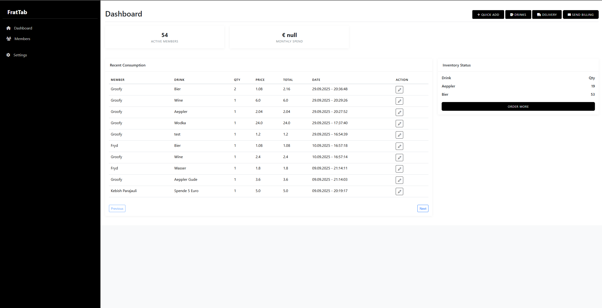
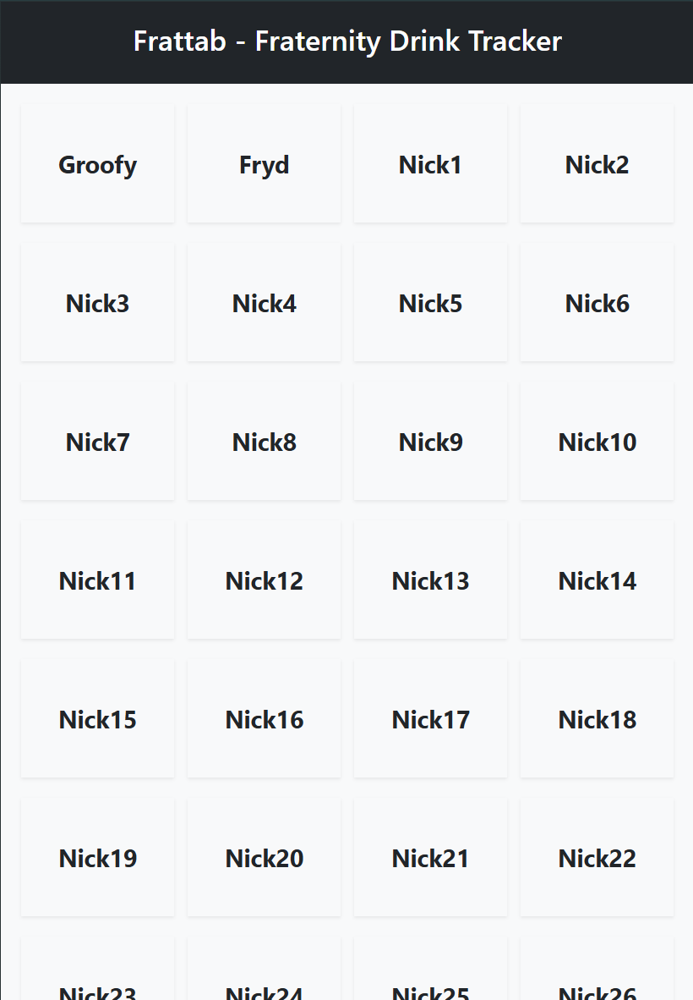
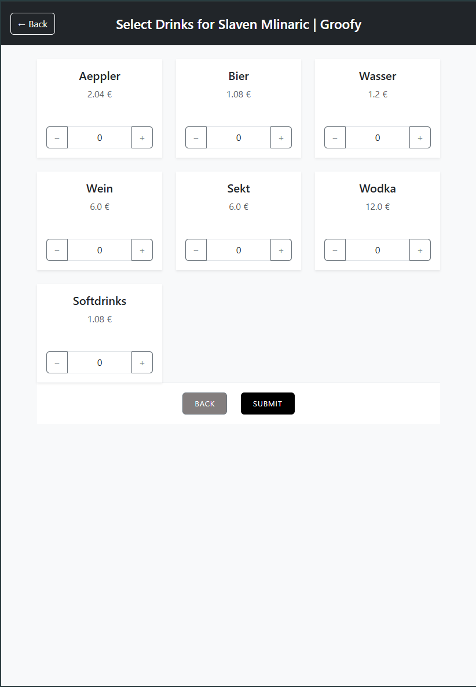
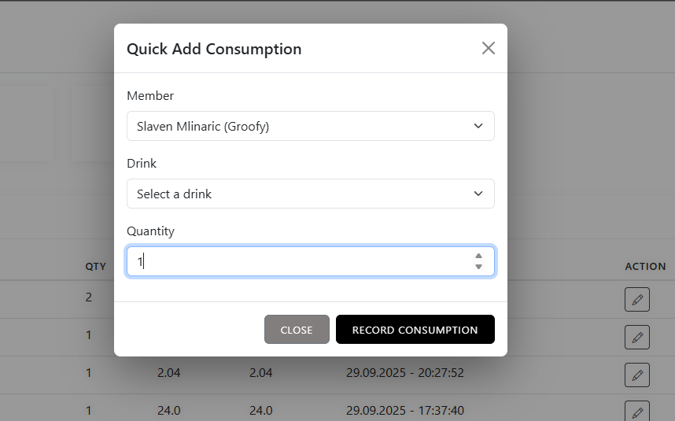
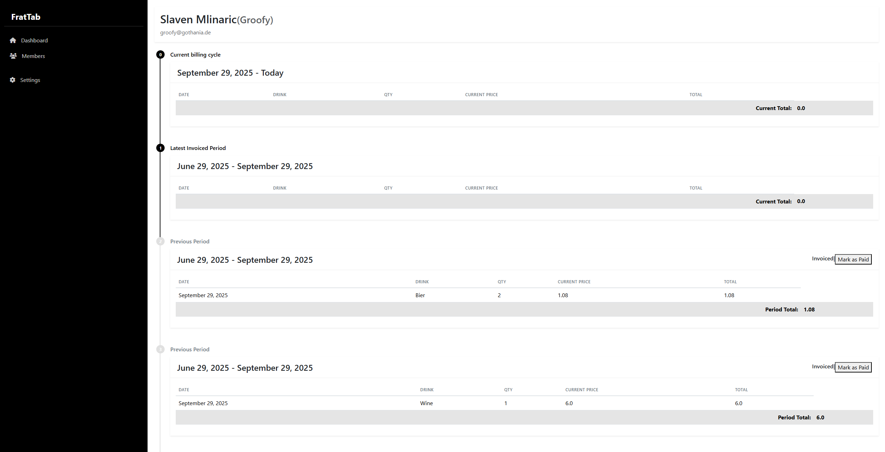
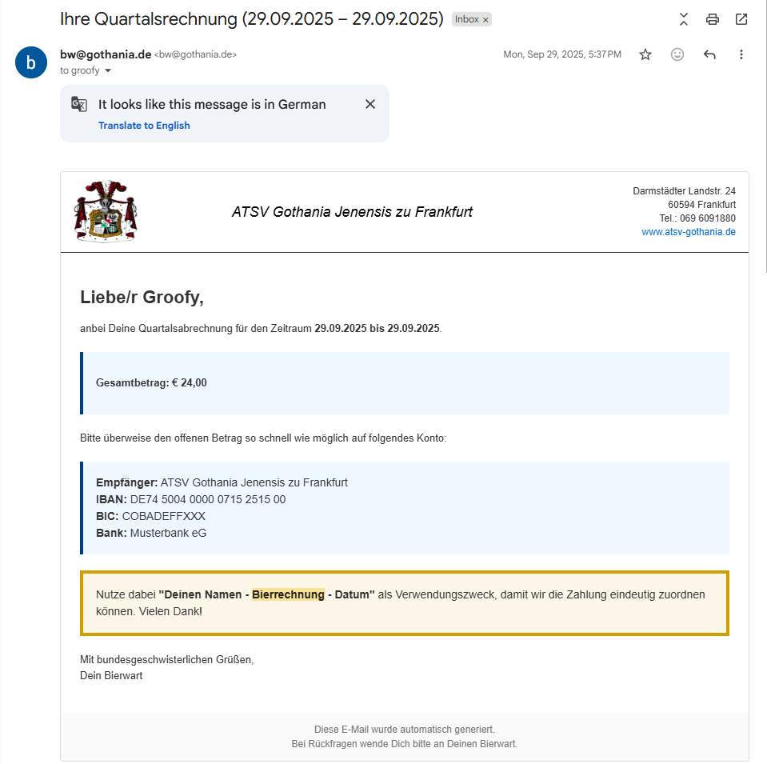

# Digital Bierwart (FratTab)

A monolithic Spring Boot web application for managing drink inventory, member consumption logging, and periodic billing for fraternities, clubs, or shared community houses.

Digital Bierwart was built to digitize a recurring real-world workflow: tracking who consumed which drinks, keeping inventory up to date, and generating billing periods that can be reviewed and sent by email. The application combines a tablet-friendly logging flow for day-to-day use with an admin-oriented dashboard for inventory, billing, and payment tracking.

> Repository / internal project name: **FratTab**

---

## Screenshots

### Dashboard


*Admin dashboard with recent consumption, inventory status, quick actions, and operational shortcuts.*

### Member Selection


*Tablet-friendly member selection screen for fast day-to-day logging.*

### Drink Selection


*Multi-drink logging flow with quantity controls and automatic total calculation logic behind the scenes.*

### Quick Add Consumption


*Fast modal flow for recording a single consumption entry directly from the dashboard.*

### Member Billing Overview


*Detailed member view showing the current billing cycle, invoiced periods, and grouped consumption history.*

### Billing Email


*HTML billing email generated by the system for a quarterly billing period, including total amount and payment details.*
---

## Features

### Consumption Logging
- Tablet-friendly member selection flow
- Multi-drink selection with quantities
- Quick single-item consumption logging
- Per-log line items and computed totals
- Automatic inventory reduction when consumption is recorded

### Inventory Management
- Maintain drink catalog with active/inactive state
- Track current stock levels
- Record deliveries / restocks
- Support pricing-related update flows through delivery handling

### Billing & Administration
- Create billing runs for a defined billing window
- Aggregate drink consumption totals per member
- Mark entries as billed and assign them to a billing run
- Track paid / unpaid billing status per member and billing period
- Review historical billing periods in the admin dashboard

### Email Delivery
- Generate HTML billing emails using Thymeleaf templates
- SMTP-based email delivery
- Environment-based mail configuration

### Platform & UX
- Server-side rendered UI with Thymeleaf
- Authentication with Spring Security
- Internationalization via message bundles
- Local Docker-based development environment

---

## Current Status

Digital Bierwart / FratTab is currently a functional prototype / working application.

The project already supports:
- member-based drink logging
- inventory tracking
- delivery / restock handling
- billing period generation
- payment state tracking
- admin dashboard workflows
- email billing infrastructure

The main focus of the project is operational correctness and practical admin workflows rather than a highly polished consumer-facing UI.

---

## Why I built this

The project was created to replace a repetitive manual process for drink tracking and recurring billing in a shared community environment. Instead of manually tracking consumption, calculating totals, and checking payment status across multiple people, the goal was to centralize the workflow in one application that supports both everyday logging and periodic billing administration.

This made the project a useful way to work on:
- business-oriented backend logic
- full request-to-database workflows
- Spring Boot architecture
- relational data modeling
- server-side rendering with Thymeleaf
- operational/admin product design

---

## Tech Stack

### Backend
- **Java 17**
- **Spring Boot 3.x**
  - Spring MVC
  - Spring Data JPA / Hibernate
  - Spring Security
  - Spring Mail
- **Lombok**

### Database
- **PostgreSQL**
- Relational data model for:
  - Members
  - Drinks
  - Deliveries
  - Drink logs
  - Log line items
  - Billing runs

### Frontend
- **Thymeleaf**
- Static CSS / JavaScript / image assets served by Spring Boot

### Local Development / Infrastructure
- **Docker Compose**
  - PostgreSQL
  - pgAdmin
  - Application container

---

## Core Workflows

### 1. Log Consumption
A member is selected, one or more drinks are chosen, quantities are entered, and the consumption is recorded. Inventory is updated automatically.

### 2. Manage Inventory
Admins can maintain drinks, track stock levels, and record deliveries to keep the system aligned with real inventory.

### 3. Run Billing
Consumption logs are grouped into billing periods. The system aggregates totals per member, marks included logs as billed, and tracks whether invoices have been paid.

### 4. Send Billing Emails
Billing data can be rendered into HTML email templates and delivered via SMTP.

---

## Repository Layout

```text
frattab/                 # Spring Boot application module
docker-compose.yaml      # Local environment (Postgres + pgAdmin + app)
PROJECT_DESCRIPTION.md   # Project overview
PROJECT_STATE_01.md      # Implementation notes / current state
Local Development
Common URLs
Application: http://localhost/
Admin dashboard: http://localhost/dashboard
pgAdmin: http://localhost:5050
Prerequisites
Docker + Docker Compose
Java 17
Maven (if running outside Docker)
Run with Docker Compose
docker compose up --build
Run the Spring Boot app locally

If you want to run the application outside Docker, start PostgreSQL first and then run the Spring Boot module normally.

Example:

cd frattab
./mvnw spring-boot:run
Configuration

The project uses environment-based configuration for infrastructure and email delivery.

Typical configuration areas include:

database connection
SMTP host / port / credentials
sender configuration
Spring profiles / runtime settings

For email delivery, the current configuration is designed around SMTP-based sending.

Architecture Notes

Digital Bierwart is intentionally built as a monolithic Spring Boot application.

This keeps the project straightforward for:

shared domain logic
admin workflows
relational data consistency
server-side rendered page flows
easier local setup and deployment

The application uses:

MVC controllers for page flows
JPA entities and repositories for persistence
Thymeleaf templates for server-rendered UI
Spring Security for protected admin areas
Data Model Overview

Main domain entities include:

Member
Drink
Delivery
DrinkLog
DrinkLogLineItem
BillingRun

Together they support:

consumption recording
inventory changes
per-period billing
payment tracking
Future Enhancements
clearer reporting / analytics on member consumption
improved billing-run overview and export options
better email preview / billing preview UX
more refined tablet-first logging flow
audit log for important administrative actions
role-based permissions beyond the current admin setup
cloud deployment / hosted usage model
License

MIT